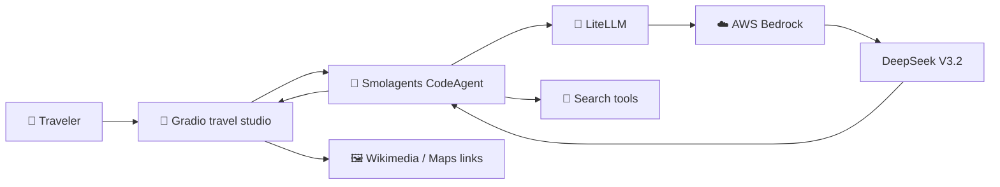

<div align="center">

<br>

### FLY TRAVEL AI Agent

# ✈️ FLY — Travel, thoughtfully designed.

**Your personal AI travel concierge.**

<br>

<a href="https://arharif.github.io/Fly-collaborative-travel-agent/">
  
</a>

<br>
<br>

<table>
  <tr>
    <td align="center" width="220">
      <a href="docs/TUTORIAL_FROM_ZERO.md">
        <strong>📖 Learn</strong>
      </a>
      <br>
      <sub>Tutorials</sub>
    </td>
    <td align="center" width="220">
      <a href="notebooks/FLY_From_Zero_to_Hugging_Face_PRO.ipynb">
        <strong>📓 Build</strong>
      </a>
      <br>
      <sub>Google Colab</sub>
    </td>
    <td align="center" width="220">
      <a href="space/">
        <strong>💬 Explore</strong>
      </a>
      <br>
      <sub>Gradio Application</sub>
    </td>
  </tr>
</table>

<br>

</div>


---

## Designed around the traveler. 🌍

FLY turns a simple travel brief into a **personalized, day-by-day itinerary**. It combines a carefully designed pink concierge interface with an AWS-hosted language model, targeted research tools, and an ongoing conversation. Travelers can adjust duration, interests, travel pace and budget—then ask a natural follow-up **without recreating the trip**.

<table>
<tr><td width="33%" valign="top"><strong>🪄 Discover</strong><br><br>Tell FLY where you're going. Select a few preferences or describe them in your own words.</td><td width="33%" valign="top"><strong>🗓️ Design</strong><br><br>Receive an explained itinerary, organized by day, with relevant attractions and optional photographs.</td><td width="33%" valign="top"><strong>💬 Converse</strong><br><br>Ask a focused question, change one stop, or explore alternatives while preserving the rest of your plan.</td></tr>
</table>

### The experience

- 🎨 **Premium travel UI** — pink dashboard, meaningful loading feedback, and responsive layouts.
- 🎯 **Cautious personalization** — stated preferences take priority over tentative assumptions.
- 🧭 **Explainable suggestions** — short user-facing reasons for major recommendations.
- 🖼️ **Grounded visual enrichment** — Wikimedia place photos when available, plus useful maps and informational links.
- 🔄 **Natural follow-ups** — focused answers rather than automatic full-itinerary regeneration.
- 🔐 **Cloud-aware security** — credentials live in Colab or Hugging Face Secrets, not in source files.

## The architecture, at a glance. 🏗️



The website and model run in **different cloud services**: Hugging Face hosts the Python/Gradio app; AWS Bedrock hosts model inference. The public GitHub Pages website hosts only the interactive tutorial—not the chatbot backend.

## Start with the path that suits you. 🧭

| Your goal | Recommended starting point |
|---|---|
| 🆕 **I am new to cloud AI** | [26-stage guided Academy](https://arharif.github.io/Fly-collaborative-travel-agent/) |
| ☁️ Configure AWS correctly | [AWS, IAM and Bedrock tutorial](docs/TUTORIAL_FROM_ZERO.md) |
| 🧪 Run the agent in a notebook | [Google Colab notebook](notebooks/FLY_From_Zero_to_Hugging_Face_PRO.ipynb) |
| 🛠️ Deploy a real Hugging Face Space | [Standalone app](space/) and [deployment stages](docs/TUTORIAL_FROM_ZERO.md) |
| 🧬 Understand the backend | [Architecture and agent internals](docs/ARCHITECTURE_AND_BACKEND.md) |
| 🔍 Debug a deployment issue | [Troubleshooting guide](docs/TROUBLESHOOTING.md) |
| 📊 Assess human–AI collaboration | [Evaluation methodology](docs/HAI_EVALUATION.md) |
| 📖 Go deeper technically | [Complete handbook](docs/COMPLETE_TECHNICAL_REFERENCE.md) · [PDF](docs/COMPLETE_TECHNICAL_REFERENCE.pdf) |

## Run it in three steps. ⚡

**01 — Prepare the environment.** Enable model invocation in AWS Bedrock and use a dedicated least-privilege IAM identity. Set `AWS_ACCESS_KEY_ID`, `AWS_SECRET_ACCESS_KEY`, and `AWS_REGION` using **Colab Secrets** or a private runtime environment.

**02 — Open the Colab notebook.** Follow its cells to test AWS authentication, load the model, initialize the agent, and launch the Gradio interface. Do not put access keys directly in Python source.

**03 — Publish to Hugging Face PRO.** Create a Gradio Space; upload the *contents* of [`space/`](space/) to the Space root; add the AWS credentials in **Space Settings → Secrets**. Use a password/access control before sharing an AWS-backed chatbot.

> **Cost and security.** Hugging Face hosting and AWS inference are separate services. Usage may incur AWS charges, external image services may be unavailable, and travel details should be verified with authoritative providers before booking.

## What's inside. 📁

```text
📦 FLY
├── 📄 README.md                 ← project overview
├── 🌐 docs/                    ← animated academy & technical references
│   ├── index.html              ← Rose / Onyx / King Green themes
│   ├── assets/                 ← visual identity & theme controls
│   └── TUTORIAL_FROM_ZERO.md   ← AWS-to-deployment tutorial
├── 📓 notebooks/               ← Colab + classroom reference cells
├── 🧠 space/                   ← live Hugging Face Python application
│   ├── app.py                  ← Gradio + user interaction
│   ├── agent_backend.py        ← Smolagents + Bedrock adapter
│   └── requirements.txt        ← pinned packages
└── 🧪 tests/                   ← offline and mock Gradio checks
```

### Make it yours

The [interactive Academy](https://arharif.github.io/Fly-collaborative-travel-agent/) includes a **Rose 🌸**, **Onyx Black 🖤**, and **King Green 🌿** theme switcher with browser-local preference persistence. It also offers a 26-stage curriculum, live progress marking, search, and copyable code examples. The GitHub README itself uses Markdown and an animated SVG hero where GitHub's image renderer supports it; JavaScript controls run on GitHub Pages, not inside README files.

---


---

## ☁️ AI × Cloud Infrastructure Architecture

**FLY Travel AI Agent — Secure, scalable, cloud-powered intelligence.**

FLY combines a conversational travel experience with AI agent orchestration and managed cloud inference. The application is hosted on **Hugging Face PRO**, powered by **Gradio and Python**, and integrates **DeepSeek V3.2 through AWS Bedrock**.

<div align="center">

<a href="docs/assets/FLY_AWS_Cloud_Infrastructure_Architecture.png">
  
</a>

<sub>Figure 01 — FLY AI × Cloud Infrastructure Architecture</sub>

</div>

### ⚡ Architecture at a Glance

| Layer | Technology | Responsibility |
|:---|:---|:---|
| 🌐 **Experience** | Hugging Face PRO · Gradio | Interactive travel dashboard and chatbot |
| ⚙️ **Application** | Python · `app.py` | Request processing, session management and responses |
| 🤖 **AI Agent** | Smolagents · CodeAgent | Orchestration, tool usage and personalization |
| 🧠 **Intelligence** | LiteLLM · AWS Bedrock · DeepSeek V3.2 | Model inference and travel recommendations |
| 🔐 **Security** | AWS IAM · Space Secrets | Access control and secure credentials |
| 🗺️ **Enrichment** | Wikipedia · Wikimedia · Google Maps | Destination information, images and links |
| 🚀 **Delivery** | Google Colab · GitHub · Hugging Face | Development, version control and deployment |

### 🔄 Request Flow

**Traveler → Gradio → Python → Smolagents → LiteLLM → AWS Bedrock → DeepSeek V3.2 → Personalized Travel Experience**

---

<div align="center">

**Learn the architecture. Build the experience. Ship responsibly.**

[📚 Academy](https://arharif.github.io/Fly-collaborative-travel-agent/) · [💻 Source](space/) · [🧪 Tests](tests/) · [📄 Reference](docs/COMPLETE_TECHNICAL_REFERENCE.md)

<sub>© 2026 FLY · Crafted by <a href="https://arharif.github.io/about-x1">@arharif</a> ✨</sub>

</div>
