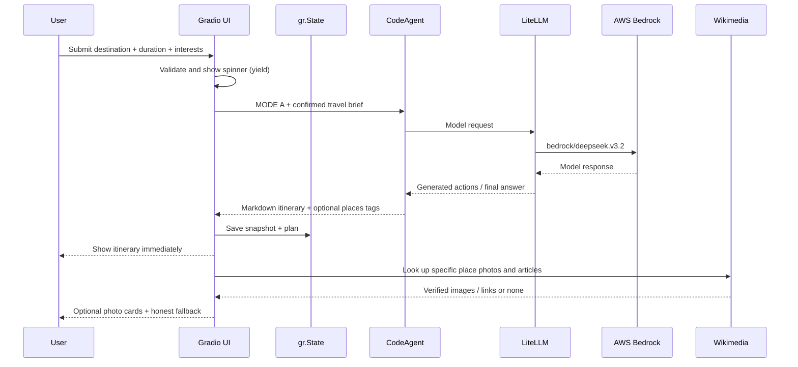
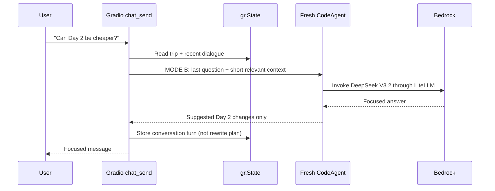

# FLY Architecture — An Engineer's Mental Model

## The 8 components (plain language)

1. **Browser**: sends preferences and renders results.
2. **Gradio UI (`space/app.py`)**: handles forms, buttons, HTML/CSS, loading animation, chat history, and per-session state.
3. **Request orchestration (`build_trip`, `chat_send`)**: builds explicit prompts from user-provided data and chooses an agent mode.
4. **Smolagents (`space/agent_backend.py`)**: wraps model/tool execution in `CodeAgent`.
5. **LiteLLM (`LiteLLMModel`)**: maps the agent's model calls to Bedrock's provider API.
6. **AWS Bedrock (`deepseek.v3.2`)**: performs model inference and returns generated content.
7. **Optional tools**: web search and page visit for current factual context.
8. **Media enrichment**: independent Wikipedia/Wikimedia lookups and Google Maps *search* links for visual presentation.

## Where Python executes

The LLM inference runs **on AWS Bedrock**, not in the Hugging Face CPU runtime. However, the **Smolagents CodeAgent's generated Python actions execute inside the Gradio server process**, which means model-driven tool/code execution must be treated as a security boundary. HF PRO hosting isn't a safety sandbox guarantee.

## Sequence: first itinerary



## Sequence: conversational follow-up



## Session memory: what persists and what does not

```python
state = {
    "built": True,
    "snapshot": {"destination": "Kyoto, Japan", "duration": "8 days"},
    "plan": "## Day 1 ...",
    "dialogue": [ ... ]
}
```

`gr.State` is per Gradio browser session. It isn't persistent customer memory and is not intended as a secure personal information store. Each `CodeAgent` request can use a fresh agent (`reset=True`), while the UI supplies selected historical context. This avoids sharing one internal agent history across unrelated users.

## Key functions in actual source

| Name | Description | File |
|---|---|---|
| `make_collaborative_travel_agent()` | create agent with model/tools/prompt | `space/agent_backend.py` |
| `_trip_snapshot()` | collect validated inputs; duration + extra interests | `space/app.py` |
| `_resolve_duration()` | normalize preset/custom durations | `space/app.py` |
| `_run_fly()` | call the fresh agent | `space/app.py` |
| `build_trip()` | generator-based itinerary flow | `space/app.py` |
| `chat_send()` | contextual reply without plan rebuild | `space/app.py` |
| `_separate_places()` | parse places-only block for optional card UI | `space/app.py` |
| `_wiki_media()` | Wikimedia/Wikipedia lookup | `space/app.py` |
| `_place_visuals()` | optional attraction image cards | `space/app.py` |
| `preview()` | test UI/media without AWS inference | `space/app.py` |
| `reset()` | reset input and session state | `space/app.py` |

## Availability is not factual correctness

A technically successful response doesn't certify that all destinations or hours are correct. Web tool lookups can fail or be stale. Photos and Wikipedia articles are supporting imagery/information, not verification of a reservation, operating hours, or price.

## Production hardening beyond the course

For a public production SaaS, consider replacing unrestricted `CodeAgent` code execution with narrower structured tool-calling, providing human review for dangerous actions, adopting short-lived AWS roles/credential federation, using an authenticated gateway plus request quotas, moving session data to a secure database with explicit retention limits, and instrumenting response quality and latency. These are recommendations, **not features already implemented here**.
