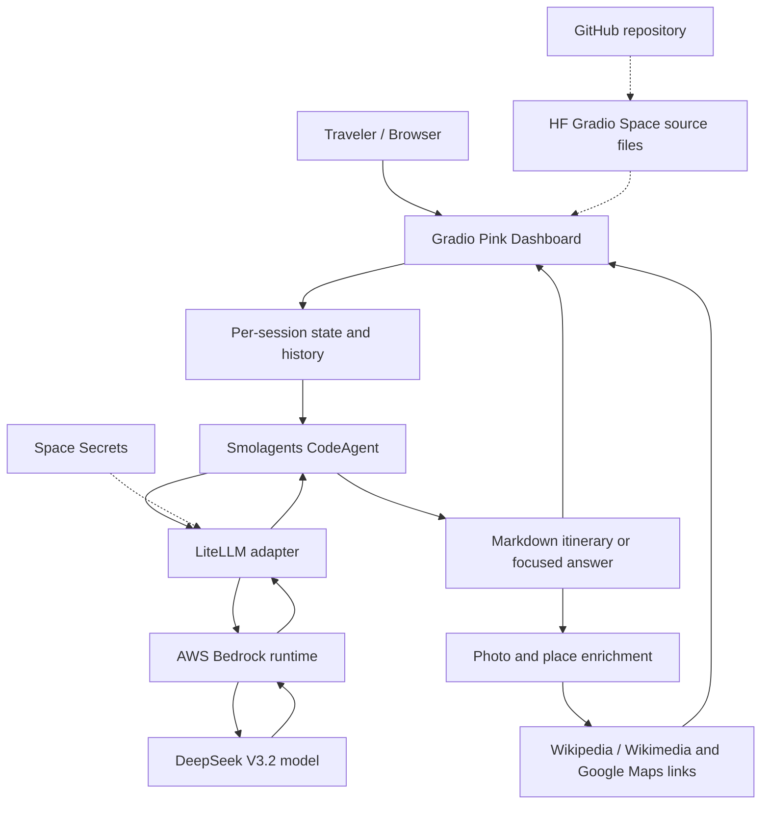

# FLY — Build a Collaborative AI Travel Agent from Zero to Hugging Face PRO

> **Hands-on learning edition · October 2026 · Level: beginner → production-aware.**  This is a reproducible tutorial for the actual FLY project, not a guarantee that every external AWS or Hugging Face call will always succeed. Follow the steps in order. The companion notebook is `notebooks/FLY_From_Zero_to_Hugging_Face_PRO.ipynb`. The deployed application is under `space/`.

## Your learning outcomes

At the end you should know how to:

1. Describe the complete request/response path: traveler → Gradio → Smolagents → LiteLLM → AWS Bedrock DeepSeek V3.2 → Gradio.
2. Create a **least-privilege IAM identity** and test a secure model request without exposing keys.
3. Understand the professor's **baseline** and its Human–AI Interaction limitations.
4. Build a personalized collaborative chatbot with custom duration, free-text interests, and contextual follow-up questions.
5. Verify generated travel suggestions, and enrich the interface with optional Wikipedia/Wikimedia photographs and maps links.
6. Deploy a standalone Gradio app to **Hugging Face PRO** using the existing Google Colab and a fine-grained token.
7. Publish the project on **GitHub**, enable an animated GitHub Pages tutorial, test, monitor, and maintain the deployment.

---

## Stage 00 — Understand what we are creating

A typical LLM is a model you ask to produce text. An **agent** is a model wrapped with instructions, action tools, and an execution loop. FLY's `CodeAgent` can decide when to use search tools; those tools are not separate LLMs. **Gradio** collects preferences and displays results; **AWS Bedrock** hosts the DeepSeek model; **Hugging Face Spaces** hosts the Python user interface, **not the model**. GitHub stores source code and static documentation.

### Two execution environments

| Environment | Code used | Secret source | Lifecycle |
|---|---|---|---|
| Google Colab | Notebook and optional imported `space/app.py` | **Colab Secrets** | Exists while Colab runtime remains active |
| Hugging Face PRO Space | `space/app.py`, `space/agent_backend.py`, dependencies | **Space Secrets** | Independent hosted build; may sleep/restart |

**Critical:** Colab's Python variables and Colab Secrets do *not* transfer automatically to Hugging Face. You must configure the Space separately.

### High-level architecture



**Expected result:** you can explain why a model's success in Colab does not imply the Hugging Face application is running.

---

## Stage 01 — Accounts, services, prerequisites

**You need:**

- Google account for [Google Colab](https://colab.research.google.com/), Python familiarity not required.
- AWS account with billing access and permission to use Amazon Bedrock (and IAM to manage an identity). Console: [AWS](https://console.aws.amazon.com/).
- A [Hugging Face](https://huggingface.co/) account with **PRO** for regular CPU-hosted Gradio Space creation, and an access token with write permission to your user namespace.
- A [GitHub](https://github.com/) account to upload and share the source.
- A browser. Do not install a GPU locally; the model is remote.

**Charges:** AWS Bedrock inference is billed by AWS; CPU Basic hosting has no hourly hardware charge but currently requires an eligible paid Hugging Face plan for Gradio Spaces. Always check the current price pages rather than assuming a fixed monthly bill. Never publish unrestricted AWS-backed inference publicly without controls.

**Checkpoint 01:** Can you log into all four services? If not, fix the missing account before continuing.

---

## Stage 02 — Choose the AWS region and inspect the model

1. Go to the **AWS Console** and sign in with your authorized IAM identity. Use the upper-right region selector; select **US East (N. Virginia), `us-east-1`** as in this project's tested configuration.
2. In the console search bar, find **Amazon Bedrock** and open it.
3. In the model catalog, find **DeepSeek V3.2** and confirm regional availability and any account onboarding requirements; current model access can involve AWS Marketplace auto-enablement/terms for some third-party models. An IAM inference policy is still required.
4. Record these strings in your personal setup notes (not secret):

```text
AWS_REGION       = us-east-1
Bedrock model ID = deepseek.v3.2
LiteLLM model ID = bedrock/deepseek.v3.2
```

**Why the prefix differs:** AWS Bedrock expects `deepseek.v3.2` as the Bedrock `modelId`; LiteLLM adds `bedrock/` to select the provider integration.

**Checkpoint 02:** You can find the model in the Bedrock documentation and explain the two identifiers. Documentation: https://docs.aws.amazon.com/bedrock/latest/userguide/model-card-deepseek-deepseek-v3-2.html

---

## Stage 03 — Create a dedicated least-privilege IAM identity

**Why:** AWS credentials let software call AWS APIs. Use a **dedicated IAM principal**, not your AWS account's root keys and not an administrator's key. AWS recommends short-lived role-based credentials where practical; static IAM access keys are a compromise for a beginner educational demo and should be rotated and restricted.

**Console procedure** (field names may shift as the console evolves):

1. In the AWS search bar open **IAM** (Identity and Access Management).
2. Select **Users** → **Create user**. Choose a clear name such as `fly-bedrock-demo`. Do not grant console access unless you specifically need it.
3. Open that user's **Permissions** tab → **Add permissions** → **Create inline policy** → **JSON** (or create a customer-managed policy and attach it). Paste the policy below:

```json
{
  "Version": "2012-10-17",
  "Statement": [
    {
      "Sid": "InvokeOnlyFlyDeepSeekV32",
      "Effect": "Allow",
      "Action": [
        "bedrock:InvokeModel",
        "bedrock:InvokeModelWithResponseStream"
      ],
      "Resource": "arn:aws:bedrock:us-east-1::foundation-model/deepseek.v3.2"
    }
  ]
}
```

4. Name the policy `FlyDeepSeekV32InvokeOnly`; review and create. If a particular model invocation path uses a different resource type (for instance a provisioned model or inference profile), follow AWS's current IAM guidance instead of indiscriminately changing the resource to `*`.
5. Open **Users → fly-bedrock-demo → Security credentials → Create access key**, select an appropriate use case, and acknowledge AWS's guidance. Save both parts securely: **Access key ID** and **Secret access key**. The secret is normally displayed once. Never show it in a screenshot or notebook output.
6. If you later rotate the credentials, update both Colab Secrets and Hugging Face Space Secrets together.

**Permission distinction:** This policy is for *inference*. `sts:GetCallerIdentity` generally works without a separate explicit allow; the STS test below confirms credential validity, not Bedrock authorization.

**Checkpoint 03:** You have a dedicated IAM identity, a model-specific policy, and a securely stored credential pair. Do not paste them in GitHub, prompts, screenshots, or chats.

Official references: https://docs.aws.amazon.com/IAM/latest/UserGuide/access_policies.html · https://docs.aws.amazon.com/bedrock/latest/APIReference/API_runtime_InvokeModel.html

---

## Stage 04 — Activate cost and security guardrails BEFORE making requests

1. From AWS, open **Billing and Cost Management → Budgets → Create budget**. Choose a cost budget in a currency/amount suitable for your course and set notification emails at one or more thresholds. Budgets can be delayed, so an alert is **not** a hard spending cap.
2. Optionally apply AWS service quotas and resource restrictions appropriate for your use. Limit app traffic, keep the Space private at first, enable a Gradio password and monitor usage.
3. Store your access keys in **Colab Secrets** and **HF Secrets**, not in `.env.example`, Python files, notebooks, GitHub Issues or GitHub Actions logs.
4. Enable MFA on the AWS identity you use to administer the account. Rotate keys immediately if exposed.

**Checkpoint 04:** Alerts configured; you understand that a private Space and a password are access barriers, not guarantees of billing protection.

Official reference: https://docs.aws.amazon.com/cost-management/latest/userguide/budgets-create.html

---

## Stage 05 — Get this GitHub project into your account

**Option A — Browser upload (beginner-friendly):**

1. Open [GitHub → New repository](https://github.com/new).
2. Name it `fly-collaborative-travel-agent`. Choose **Private** while reviewing the files; publish later if appropriate. **Do not initialize with a README** if you are uploading this prepared package.
3. Create the repository. Click **uploading an existing file** (or **Add file → Upload files** on the Code tab). **Extract the ZIP on your computer**. Drag the *contents* of the extracted folder—not the ZIP alone—onto the GitHub upload area. GitHub's web uploader may have per-file/count limits; use Git if the browser refuses a large folder upload.
4. Confirm that `space/`, `notebooks/`, `docs/` and `.github/` appear in the repository. Commit the upload. If dotfiles didn't upload, add `.gitignore` separately.

**Option B — Git command line** (if comfortable):

```bash
cd FLY_Zero_to_Deployment_GitHub
git init
git add .
git commit -m "Initial Fly travel agent tutorial and app"
git branch -M main
git remote add origin https://github.com/YOUR_GITHUB_USERNAME/fly-collaborative-travel-agent.git
git push -u origin main
```

If the remote repo is already initialized, pull/reconcile rather than force pushing. GitHub authentication may require its credential manager or an approved token; do not put tokens in the Git URL or shell history.

**Checkpoint 05:** You can open GitHub and see both the notebook file and `space/app.py`.

---

## Stage 06 — Open the reproducible Colab notebook

1. In GitHub navigate to `notebooks/FLY_From_Zero_to_Hugging_Face_PRO.ipynb`.
2. Open in Colab via GitHub's notebook link or paste this pattern into your browser:

```text
https://colab.research.google.com/github/YOUR_GITHUB_USERNAME/fly-collaborative-travel-agent/blob/main/notebooks/FLY_From_Zero_to_Hugging_Face_PRO.ipynb
```

3. Choose **File → Save a copy in Drive** if you want to edit it without changing the GitHub version.
4. In the first configuration code cell, change `GITHUB_USERNAME` and `GITHUB_REPOSITORY` to your real values. The notebook will clone your repository into the temporary Colab filesystem. If the repository is private, cloning needs authorized GitHub credentials; **do not paste a GitHub personal token into public notebook code**. A temporary, reviewed public repo is simpler for this beginner exercise, or upload the package from your device instead.
5. Runtime → **Change runtime type** → CPU (GPU not required), then run the notebook cells **in order**.

**Checkpoint 06:** The first verification cell prints the path to `space/app.py` and `space/requirements.txt`.

---

## Stage 07 — Install Python dependencies in Colab

The notebook runs `%pip install -r .../space/requirements.txt`. This ensures the runtime contains Gradio, Smolagents, LiteLLM, boto3, requests, search dependencies and HTML parsing tools. Packages are installed within that Colab session; a runtime restart normally requires reinstalling.

**Important versions in this project:** `gradio==6.5.1` and `smolagents[litellm]==1.26.0`. They work with the UI component settings in this package. **Gradio 6 does not accept `gr.Chatbot(type="messages")`**; the parameter was removed. Style settings such as CSS/theme are supplied to `launch()`, not the `Blocks()` constructor.

**Checkpoint 07:** `import gradio, smolagents, boto3, litellm` executes; no import traceback.

---

## Stage 08 — Add AWS credentials to Colab Secrets

On the Colab left toolbar, open the **key-shaped Secrets panel**. Add **two separate secrets**:

| Name (exact spelling) | Value | Notebook access? |
|---|---|---|
| `AWS_ACCESS_KEY_ID` | your IAM access key ID | **On** |
| `AWS_SECRET_ACCESS_KEY` | its matching secret access key | **On** |
| `AWS_SESSION_TOKEN` | only if using temporary STS credentials | On if used |
| `HF_TOKEN` | your HF fine-grained write token, later | On if used |

The notebook securely retrieves these via `from google.colab import userdata`. It sets AWS environment variables for the current runtime; it should print **only masked identity information**, never the keys.

**Checkpoint 08:** No secret value appears in an output cell. You can demonstrate its presence via `bool(...)` rather than printing it.

---

## Stage 09 — Validate AWS authentication separately from authorization

Use `boto3.Session` with your credentials and `sts.get_caller_identity()` to test the signature. For example:

```python
import boto3
from google.colab import userdata
session = boto3.Session(
    aws_access_key_id=userdata.get("AWS_ACCESS_KEY_ID"),
    aws_secret_access_key=userdata.get("AWS_SECRET_ACCESS_KEY"),
    region_name="us-east-1",
)
who = session.client("sts").get_caller_identity()
print("AWS credentials accepted. Identity check succeeded.")
```

You must not print the full identity/account information into a public screenshot. A successful identity request establishes that credentials are recognized; **it does not yet prove Bedrock inference permission**.

**If SignatureDoesNotMatch:** check that the ID and secret belong to the same active pair; remove stray spaces, rotate stale keys, and refresh the boto3 Session after changes. Temporary credentials additionally require the session token.

**Checkpoint 09:** the identity request succeeds.

---

## Stage 10 — Make the first real DeepSeek V3.2 request

The notebook calls the Bedrock model using LiteLLM and a small token limit:

```python
from litellm import completion
response = completion(
    model="bedrock/deepseek.v3.2",
    messages=[{"role":"user","content":"Explain an AI agent in one sentence."}],
    max_tokens=120,
)
print(response.choices[0].message.content)
```

This is the first **potentially billable model request**. If you see `AccessDeniedException`, check the IAM policy's action/resource and account/model onboarding. If you see an unsupported `stopSequences` error, see Stage 11 (that is a parameter issue, not an AWS access-key problem).

**Checkpoint 10:** a short model answer is returned with no traceback.

---

## Stage 11 — Understand LiteLLM and the `stopSequences` fix

**LiteLLM** is a compatibility layer. The same Smolagents `CodeAgent` can refer to an abstract model wrapper, but its requests still must conform to what the specific Bedrock model accepts.

The working FLY backend configures:

```python
from smolagents import LiteLLMModel, REMOVE_PARAMETER
import litellm
litellm.drop_params = True
model = LiteLLMModel(
    model_id="bedrock/deepseek.v3.2",
    max_tokens=1800,
    stop=REMOVE_PARAMETER,
)
```

In this exact tested stack, Smolagents may otherwise supply `stop` and LiteLLM maps it to Bedrock's unsupported `stopSequences` argument for DeepSeek V3.2. `REMOVE_PARAMETER` means **omit the field entirely**. An empty `stop=[]` still passes a field on some integrations. Do not remove this fix casually when upgrading dependencies.

**Checkpoint 11:** you can explain provider ID versus model ID, and why the special setting matters.

---

## Stage 12 — Smolagents CodeAgent and tools (how the backend thinks)

Open `space/agent_backend.py`:

- `LiteLLMModel` connects the model to AWS Bedrock using environment credentials.
- `FLY_INSTRUCTIONS` defines **Mode A: itinerary** and **Mode B: conversational follow-up**.
- `WebSearchTool(max_results=2)` can discover web information when current facts matter.
- `VisitWebpageTool()` can read linked webpages when the agent chooses to use it.
- `CodeAgent(..., max_steps=4)` limits its action loop; smaller limits can improve latency but sometimes prevent complex research.
- `make_collaborative_travel_agent()` creates a **fresh agent per request** to prevent accidental reuse of one traveler's internal agent memory for another.

The `CodeAgent` executes Python proposed by a language model. That creates additional security risk; require authentication, update dependencies, limit privileges, do not expose private tools or broad file/network access, and keep the app as a controlled educational demonstration rather than assuming model-generated code is intrinsically safe.

```python
agent = make_collaborative_travel_agent()
answer = agent.run("MODE B - CONVERSATION. Recommend one quiet Kyoto place.", reset=True)
```

**Why `reset=True` can still support conversations:** Gradio's session `State` stores the travel brief, original plan and recent dialogue, and injects relevant context into *new agent prompts*. The agent's own execution memory is intentionally fresh.

**Checkpoint 12:** You can explain *frontend state vs agent internal state*.

---

## Stage 13 — Understand the professor's notebook, cell by cell

> The professor's original notebook has some cells not provided to this package. We only label the ones whose roles were verified from the project work. The **standalone notebook in this repository uses its own sequential numbering** and is intended to be self-contained.

| Original professor cell | Purpose | Keep / modify |
|---|---|---|
| 5 | AWS session / credentials setup | Configure securely; no hard-coded credentials |
| 6 | DeepSeek V3.2 via `LiteLLMModel` | Keep `stop=REMOVE_PARAMETER` |
| 8 | Helper tools and user input tool | Maintain baseline dependencies and valid tool definitions |
| 9 | Baseline `travel_assistant_base` | Preserve for before/after comparisons |
| 10 | Baseline Smolagents GradioUI | Test, collect evidence; Gradio version must match |
| 11–12 | Baseline replay / agent memory inspection | Analyze actions and tool calls |
| 14 | Improved `collaborative_travel_assistant` | Enforce R1–R4 and proper personalization |
| 16 | Improved pink interactive Gradio UI | Intake, plans, follow-up conversations, optional images |
| 19 and later | HF username, publication, reload, write-up | Must use a real **Gradio Space** for Python execution; Static Space holds source only |

**Checkpoint 13:** Baseline and improved agents use the same DeepSeek model for a fairer qualitative A/B experiment.

---

## Stage 14 — R1–R4: what changed in the redesigned human–AI interaction

| Requirement | User experience | Where implemented | How to test |
|---|---|---|---|
| R1 Personalization | One setup brief, custom duration, typed interests | Gradio form and Mode A prompt | Enter `Custom → 2 weeks` plus typed interest, inspect snapshot |
| R2 Explainability | Reasons tied to interests, budget, pace | `FLY_INSTRUCTIONS`, itinerary prompt | Check each major recommendation has a brief reason |
| R3 Useful visuals | Day-by-day plan and real destination information, optional images | `app.py` Wikimedia enrichment | Preview (no AWS), verify photo source and links |
| R4 User control | Normal follow-up chat without rewriting the plan | `chat_send`, `gr.State`, Mode B | Ask about Day 2 costs, verify original plan remains |

**Microsoft HAI guideline links:** G4 contextual relevance, G8 efficient dismissal, G9 efficient correction, G11 why/what explanation, G12 use recent interactions, G14 cautious adaptation. These are evaluation lenses, not automatic claims of violation; use real transcripts to determine whether the baseline actually fails.

**Checkpoint 14:** You can demonstrate the features in a fresh chat and a follow-up chat.

---

## Stage 15 — The Gradio UI: interface and event wiring

Open `space/app.py`. Key components:

1. `gr.Blocks(...)`: parent layout.
2. `gr.Textbox`, `gr.Dropdown`, `gr.CheckboxGroup`, `gr.Number`: travel inputs.
3. `gr.Chatbot`: the visible conversation.
4. `gr.State`: per-browser-session state with `built`, `snapshot`, `plan`, `dialogue`.
5. `.click(...)` and `.submit(...)`: **event bindings** between buttons and Python functions.
6. `build_trip(...)`: validates preferences, streams a loading state, calls the model, shows the result, then looks up images.
7. `chat_send(...)`: appends a question to chat history, calls the model in Mode B, returns a focused answer, preserves the plan.
8. `reset(...)`: resets both the form and session state.
9. `fly_demo.queue(default_concurrency_limit=1)`: allows streaming `yield` updates, reduces concurrent expensive requests within a process.

The hosted Space launches with `share=False`, because the Hugging Face app already has a public/protected URL; the local Colab launch can use `share=True`. With Gradio 6.5.1, `theme` and `css` belong to `.launch()`; don't pass `type="messages"` to `gr.Chatbot`.

**Why there are animated progress indicators:** a model request may take seconds or longer. The generator yields a visible status before calling the agent, and another status before optional image lookup. The animation is feedback, **not an accurate percent completion**.

**Checkpoint 15:** Preview (no AWS) and reset work without invoking DeepSeek; Generate and Send work with configured AWS credentials.

---

## Stage 16 — Images, links and cautious factual claims

The app uses independent media lookups—**the language model does not supply trusted image URLs**.

- Model returns readable Markdown and may include a small `places` code block listing actual recommended attractions.
- `_separate_places` parses and hides that block, and `_place_visuals` requests Wikipedia/Wikimedia information independently.
- A fallback search strategy normalizes alternative spellings and diacritics to improve matching.
- Photo URLs are constrained to Wikimedia hosts; article URLs to Wikipedia hosts.
- Google Maps **search** links are generated for relevant place names; they are not verified reservations or directions.
- If no verified photograph is available, the itinerary still displays. The UI must never claim a photograph was verified by the model alone.

Photos can fail because of rate limiting, network policy, missing PageImages, alternate names or browser blocking. **No photo** is safer than an unrelated or fabricated photo.

**Checkpoint 16:** A travel plan is usable even when image lookup fails; the UI can show an honest fallback status.

---

## Stage 17 — Local end-to-end test before hosting

Run the notebook's **local Gradio launch** after model authentication works. If you imported `app.py` from `space/`, you are testing the *same* backend that Hugging Face will run.

Test this sequence:

1. Click **Preview (no AWS)** and check the page renders and results appear.
2. Choose **Kyoto** from the example buttons.
3. Verify `Custom` duration is editable and both selected + typed interests are passed.
4. Click **Design my journey**; confirm itinerary is day-by-day and tailored.
5. Ask **“Could Day 2 be quieter and less expensive?”** in Send; it should answer the specific question, not rewrite the whole trip.
6. Click **Start over** and confirm there is no retained trip information.
7. Repeat with a different destination, and preserve before/after evidence for your assignment.

**Checkpoint 17:** app works locally and evidence is recorded. The Gradio URL from Colab is temporary and may stop after the runtime closes.

---

## Stage 18 — Create the Hugging Face fine-grained token

1. Open https://huggingface.co/settings/tokens .
2. Select a **fine-grained** token, name it e.g. `Fly-Course-Deploy`.
3. Grant only the necessary permission to write repositories under **your personal namespace** (or scope it to this Space when available). Extra model inference permissions are not needed because this project calls AWS Bedrock.
4. Copy it once; save it in **Colab Secrets → HF_TOKEN**, enable notebook access.
5. Run the notebook's HF authentication cell and confirm the correct account username. **Do not print the token.**

**Checkpoint 18:** authentication succeeds; username is correct; no token is displayed in output.

---

## Stage 19 — Create a real Gradio Space using PRO

1. Open https://huggingface.co/new-space or use your own Spaces screen → **Create new Space**.
2. Space name `haii-fly-travel-live` or your own. Choose **Gradio**, not Static HTML; use **CPU Basic** (the model runs on AWS). Choose **Private** while testing. You can later consider Protected/Public with appropriate app authentication and usage limits.
3. Confirm the user/account has the needed PRO subscription for CPU Gradio Space creation.
4. Create the Space using the website **or** let the included Colab publishing cell create/reuse it. **Do not create a Static Space at the same ID.**
5. In the **root of the Space** you need `app.py`, `agent_backend.py`, `requirements.txt`, `README.md`. Do *not* upload the whole GitHub repo root to the Space: files must be at the root of the Space repository.

**Checkpoint 19:** the Space's Files tab shows these exact four files at root, and the README YAML says `sdk: gradio`, `app_file: app.py`. A `short_description` longer than 60 characters is rejected with HTTP 400; the included README has already been corrected and validated.

---

## Stage 20 — Configure Hugging Face Space Secrets (different from Colab)

Open **Space → Settings → Variables and secrets**. Add:

| Type | Key | Value |
|---|---|---|
| Secret | `AWS_ACCESS_KEY_ID` | matching IAM key ID |
| Secret | `AWS_SECRET_ACCESS_KEY` | matching IAM secret |
| Variable | `AWS_REGION` | `us-east-1`, if enabled |
| Secret | `FLY_APP_PASSWORD` | long unique visitor password |
| Secret, optional | `FLY_APP_USER` | `traveler` or your chosen name |
| Secret, conditional | `AWS_SESSION_TOKEN` | only when using temporary AWS credentials |

Changing secrets/variables typically restarts the application. Do not put them into repo files, README, GitHub issue, screenshots, or the public chat. The app reads these environment variables at runtime. **Private Space** access is different from **in-app password** access; a Protected Space's hosted app may be reachable even when source is private, so authentication still matters.

**Checkpoint 20:** Space now has the required keys visible *by name*, without exposing their values. Preview works; a real AI request succeeds.

---

## Stage 21 — Publish files through Google Colab (no manual ZIP surgery)

Use the notebook's HF deploy cell: it reads **your cloned GitHub repo's `space/` folder**, confirms SDK/metadata, creates or reuses the correct Gradio Space, and uploads the four files. It refuses to overwrite a Static Space. Code is published, then Hugging Face builds the app automatically.

> Tip: The notebook's publishing step requires valid `HF_TOKEN`. It does not send AWS secrets to Hugging Face; you add those separately in the Space Settings.

After upload, open the Space → **Files** and then **App**. If the app shows **Building**, inspect build logs. If it shows **Running**, sign in (if password configured) and run Preview + Generate + Send. Success means the app is actually responding, not merely that the files were uploaded.

**Checkpoint 21:** Hosted app works even after you close Google Colab.

---

## Stage 22 — Deployment health, log triage, costs and updates

**Where to look:** Space → **Logs → Build** for package installation errors; **Logs → Container** for Python startup/model/tool failures.

**Deploy a new version:** modify GitHub source → run `tests/test_repository.py` and UI mock tests → commit → rerun the notebook upload cell → watch Space rebuild → test Preview and Generate. A GitHub commit by itself does **not** automatically update the HF Space unless you set up explicit synchronization.

**Privacy:** the app stores the travel session in Gradio state, not a permanent customer database. Users should avoid entering health, identity or other sensitive personal data. The model sees relevant travel preferences and prior itinerary as prompt content.

**Cost model:** actual spend depends on Bedrock input/output tokens, whether web tools add more model steps, number of visitors, account quotas, and the chosen HF hardware. Avoid quoting invented per-query prices. Configure budgets and monitor. PRO is separate from Bedrock billing.

**Checkpoint 22:** You can rebuild the app, identify a failed deployment stage, and recover without exposing secrets.

---

## Stage 23 — Put the animated documentation on GitHub Pages

This repository ships a standalone animated website at **`docs/index.html`**, with no API calls and no credentials.

1. Push this GitHub repo, then open **GitHub → Repository Settings → Pages**.
2. Under **Build and deployment** select **Deploy from a branch**.
3. Select branch **main**, folder **/docs**, then Save.
4. After GitHub finishes its Pages build, visit the site URL GitHub shows. The site usually follows a pattern such as `https://YOUR_GITHUB_USERNAME.github.io/fly-collaborative-travel-agent/`.
5. GitHub Pages content is normally publicly accessible; **never put AWS or HF secrets inside docs**.

**Checkpoint 23:** you can navigate the interactive chapters, see animated progress indicators, search headings, mark checklist steps and follow architecture links.

Official GitHub reference: https://docs.github.com/en/pages/getting-started-with-github-pages/configuring-a-publishing-source-for-your-github-pages-site

---

## Stage 24 — Your assignment's scientific evaluation: baseline vs improved

Keep the professor's baseline agent unchanged and test both agents with **identical prompts**. Record authentic outputs, rather than writing idealized answers and calling them evidence.

| Test | Input | Metric | Interpretation |
|---|---|---|---|
| Information burden | Kyoto 4-day trip | Number of unsolicited questions, words, time | R1/G4 |
| Rationale | Same Kyoto prompt | Number/proportion of named stops with explicit reason | R2/G11 |
| Practical output | Same prompt | Real locations, grounded links, available photos | R3/G4 |
| Correction | “Actually, I want a central location…” | Preservation of unchanged constraints | R4/G9/G12/G14 |

Include at least **three empirical comparisons** per your assignment requirements, using timestamps, actual transcripts and a small method section (same model, equal tools when appropriate, same prompts, same response budget where possible). Note that two AI runs can differ without code changes, and performance improvement cannot be declared from one cherry-picked run. For stronger evidence, repeat with several prompts and assess reliability. Do **not** use Preview's demo plan as actual model evidence.

**Checkpoint 24:** You can explain where each reported improvement was observed and where uncertainty remains.

---

## Stage 25 — Final delivery, demonstration, and maintenance

Your project is complete for demonstration when:

- [ ] GitHub repository contains `space/`, `notebooks/`, `docs/`, `tests/`, and this tutorial.
- [ ] Automated static tests pass, and no credentials are in the repository.
- [ ] Colab can authenticate to AWS, invoke DeepSeek, and run the pink demo (or your original notebook still does so).
- [ ] Hugging Face Space is a **Gradio** Space, not Static HTML.
- [ ] Space's AWS credentials, region and app password are set privately.
- [ ] Hosted Preview works and real itinerary generation succeeds.
- [ ] Hosted chat answers follow-ups without automatically rebuilding the full plan.
- [ ] Photo fallback is honest if Wikimedia has no image.
- [ ] Cost/security controls and demo account sharing are documented.
- [ ] GitHub Pages documentation works on desktop/mobile.
- [ ] The professor's required before/after evidence and write-up are saved separately.

---

## Appendix A — Troubleshooting by error message

| Exact symptom | Likely cause | Corrective action |
|---|---|---|
| `SignatureDoesNotMatch` | Wrong AWS key pair / stale session | Update both secrets; temporary credentials also need session token; restart session/client |
| `AccessDeniedException ... bedrock:InvokeModel` | IAM missing / wrong resource / model access | Review targeted IAM policy, region, model availability and enablement |
| `This model doesn't support stopSequences` | Smolagents/LiteLLM sends unsupported stop | Preserve `stop=REMOVE_PARAMETER` in the tested stack |
| `Chatbot.__init__ ... type` | Gradio 6 constructor changed | Remove `type="messages"`; pin project version |
| `gradio.components has no attribute Component` | Inconsistent Gradio installation/imports | Reinstall pinned compatible versions and restart runtime |
| `402 Payment Required` when creating Gradio Space | No qualifying paid HF plan | Verify PRO is on the authenticated HF account; Static Space isn't a Python host |
| `short_description length <= 60` | Invalid Space README YAML | Use included validated `space/README.md` |
| Space published but Python app doesn't run | SDK is `static` or files not at repo root | Use **Gradio** Space and correct root files |
| “Fly is not yet connected to AWS” | HF Space lacks credential secrets | Add them under **Space Settings → Secrets**, then restart |
| Images missing | Wikimedia lookup/network/matching failed | Test Preview; check image logs; don't invent URLs |
| Space seems to run forever in Colab | `debug=True` blocks / server thread | Stop the running cell; prefer non-blocking local launch for notebook workflow |
| `CodeAgent.from_hub` returns 404 | Space missing / no uploaded `agent.json` / private access | Confirm repo exists, correct type, authorization; app publishing is not same as serialized agent source |
| “refused to connect” in Static Space | Hugging Face page blocked within iframe | Open repository directly in a new tab; deploy a real Gradio Space for chat |

---

## Appendix B — Quick commands and links

```text
GitHub repository:       https://github.com/YOUR_GITHUB_USERNAME/fly-collaborative-travel-agent
GitHub Pages:            https://YOUR_GITHUB_USERNAME.github.io/fly-collaborative-travel-agent/
Hugging Face live app:   https://huggingface.co/spaces/YOUR_HF_USERNAME/haii-fly-travel-live
HF Access Tokens:        https://huggingface.co/settings/tokens
AWS IAM:                 https://console.aws.amazon.com/iam/
Amazon Bedrock:          https://console.aws.amazon.com/bedrock/
AWS Billing/Budgets:     https://console.aws.amazon.com/billing/home
Colab:                   https://colab.research.google.com/
```

All account-specific URLs above are *patterns*, not promises that your repository exists or is visible to everyone.

## Appendix C — Official reference links

- [AWS Bedrock DeepSeek V3.2](https://docs.aws.amazon.com/bedrock/latest/userguide/model-card-deepseek-deepseek-v3-2.html)
- [AWS model access guidance](https://docs.aws.amazon.com/bedrock/latest/userguide/model-access.html)
- [AWS least-privilege IAM](https://docs.aws.amazon.com/IAM/latest/UserGuide/access_policies.html)
- [AWS Budgets](https://docs.aws.amazon.com/cost-management/latest/userguide/budgets-create.html)
- [Hugging Face Gradio Spaces](https://huggingface.co/docs/hub/spaces-sdks-gradio)
- [Hugging Face Spaces Overview](https://huggingface.co/docs/hub/spaces-overview)
- [Hugging Face repository upload](https://huggingface.co/docs/huggingface_hub/main/guides/upload)
- [GitHub Pages publishing](https://docs.github.com/en/pages/getting-started-with-github-pages/configuring-a-publishing-source-for-your-github-pages-site)
- [Microsoft Guidelines for Human–AI Interaction (PDF)](https://www.microsoft.com/en-us/research/wp-content/uploads/2019/01/Guidelines-for-Human-AI-Interaction-camera-ready.pdf)

**End of hands-on tutorial.** For a deeper explanation of each software component and the original assignment analysis, read `docs/COMPLETE_TECHNICAL_REFERENCE.md` and `docs/CELL_BY_CELL.md`.
